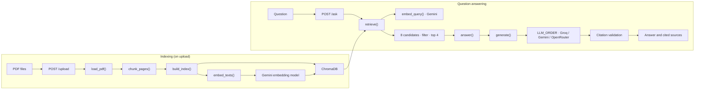

# Document Q&A with Citations

Upload PDFs, ask questions about their contents, and receive answers with page citations.


## Contents

- [Live demo](#live-demo)
- [Demo](#demo)
- [Features](#features)
- [How it works](#how-it-works)
- [Architecture](#architecture)
- [Tech stack](#tech-stack)
- [Evaluation](#evaluation)
- [Run locally](#run-locally)
- [Environment variables](#environment-variables)
- [API reference](#api-reference)
- [Deployment](#deployment)
- [Design decisions and limits](#design-decisions-and-limits)
- [Known limitations](#known-limitations)
- [Roadmap, license, and attribution](#roadmap-license-and-attribution)

## Live demo

**Live app:** [TBD](https://your-demo.example.com)

The free Render backend may take about a minute to wake up. Uploaded-document sessions are kept in memory and are lost when the backend restarts.

## Demo


*Demo GIF placeholder. Add the recording at `docs/images/demo.gif`.*

## Features

- Answers include citations linked to source cards with PDF page numbers.
- Uses retrieved passages only; returns “I could not find this in the uploaded documents.” when retrieval is empty or below the similarity threshold.
- Processes uploaded PDFs and session indexes in memory; uploaded PDF bytes are not written to disk by the upload handler.
- Uses the configured `LLM_ORDER` for answer-provider fallback. Gemini is the configured embedding provider; embedding has no provider fallback.
- Includes a question evaluation suite and retrieval-only chunk comparison.

## How it works

The repository's `AGENTS.md` contains Next.js editing guidance, not a RAG pipeline. These ten steps are mapped from the current backend and frontend code.

1. `addFiles()` checks the selected files for PDF names, individual file size, and file count in `rag-frontend/frontend-scaffold/app/page.tsx`.
2. `indexDocuments()` sends the files as multipart form data to `POST /upload`.
3. `upload()` in `rag-backend/main.py` validates the PDF signature, file count, file size, and total page count.
4. `load_pdf()` in `rag-backend/ingest.py` extracts non-empty page text with `pypdf`.
5. `chunk_pages()` splits page text into chunks using `RAG_CHUNK_SIZE` and `RAG_CHUNK_OVERLAP`.
6. `build_index()` creates an in-memory ChromaDB collection, calls `embed_texts()`, and stores documents, vectors, and page metadata.
7. `ask()` checks the session and sends the question to `answer()` in `rag-backend/rag.py`.
8. `retrieve()` embeds the question with Gemini, queries up to eight candidates, filters likely exercise lists unless requested, and keeps up to four chunks.
9. `answer()` checks the best similarity against `0.35`, then calls `generate()` with the retrieved context and configured `LLM_ORDER`.
10. `answer()` normalizes citations, removes citation numbers outside the retrieved set, and returns only sources cited by the answer.

The bundled sample index is built separately by `rag-backend/build_sample_index.py`. At startup, `main.py` loads `sample_index.json` through `load_precomputed_index()` without calling the embedding API.

## Architecture



The current local `.env` sets `LLM_ORDER=groq,gemini,openrouter`; deployed environments can use a different order.

## Tech stack

| Layer | Tool | Why it is used |
|---|---|---|
| Frontend | Next.js, React, TypeScript | Browser UI and upload/question interactions. |
| Answer rendering | `react-markdown`, `remark-gfm` | Renders Markdown answers and GitHub Flavored Markdown. |
| API | FastAPI, Uvicorn | HTTP endpoints and ASGI server. |
| PDF parsing | `pypdf` | Extracts page text and reads page counts. |
| Vector store | ChromaDB | Stores and retrieves chunk embeddings in process memory. |
| Embeddings | Google Gemini through `google-genai` | Embeds uploaded chunks and retrieval questions. |
| Answer providers | Groq, Gemini, OpenRouter | Generates answers in configured `LLM_ORDER`. |
| Rate limiting | SlowAPI | Applies request limits to API routes. |
| Evaluation | `evaluate.py`, `test_questions.json` | Measures retrieval hits, keyword answer matches, and exact refusals. |

## Evaluation

`rag-backend/test_questions.json` currently contains **19 questions**: **16 answerable** questions with expected source, page, and keywords, and **3 unanswerable** questions.

- **Hit rate@4:** an answerable question is a hit when one of the four returned chunks comes from the expected PDF and is on the expected page or within one page of it.
- **Answer accuracy:** every expected keyword must occur as a case-insensitive substring of the generated answer.
- **Refusals:** an unanswerable question is correct only when the answer exactly equals `I could not find this in the uploaded documents.`
- **Citation support:** **NOT MEASURED** by `evaluate.py`. Runtime code filters invalid citation numbers, but the evaluator does not check whether each sentence is semantically supported by its cited passage.

The checked-in `evaluation_results.json` is an older run against **18 questions**, not the current 19-question suite. It recorded errors for all questions, so its answer and refusal metrics are not successful evaluation results.

Run the evaluator from `rag-backend` with the required environment variables set: `python evaluate.py --preflight`, `python evaluate.py --full`, or `python evaluate.py --retrieval-only`.

| Provider | Model recorded in result file | Questions recorded | Completed | Failed | Stored hit rate@4 | Answer accuracy | Correct refusals |
|---|---|---:|---:|---:|---:|---|---:|
| Gemini | `gemini-3.8-flash` (historical result label) | 18 | 0 | 18 | 0.0 (not meaningful for this all-error run) | NOT MEASURED (`null`; 0 evaluated) | 0 of 3 (all questions errored) |

## Run locally

### Prerequisites

- Python and pip. Minimum Python version: **NOT MEASURED** in the project manifests.
- Node.js and npm. Minimum Node.js version: **NOT MEASURED** in `package.json`.
- A Gemini API key and an available Gemini embedding model for indexing PDFs and questions.
- An answer-provider API key and model for generating answers.

### Backend

Run these commands in a terminal. Keep the backend terminal open.

**Windows PowerShell**

```powershell
cd .\rag-backend
python -m venv .venv
.\.venv\Scripts\Activate.ps1
python -m pip install -r requirements.txt
Copy-Item .env.example .env
```

Edit `.env` and set the required keys and models. The repo already includes `docs/kebo101.pdf` and `sample_index.json`. To rebuild the sample vectors after changing PDFs or chunk settings, run:

```powershell
python build_sample_index.py
```

Start the API:

```powershell
uvicorn main:app --reload --port 8000
```

**macOS / Linux**

```bash
cd rag-backend
python3 -m venv .venv
source .venv/bin/activate
python -m pip install -r requirements.txt
cp .env.example .env
# Edit .env and set the required keys and models.
uvicorn main:app --reload --port 8000
```

To rebuild the sample index after changing the PDFs or chunk settings, run this from `rag-backend`:

```bash
python build_sample_index.py
```

The local API uses `http://localhost:8000` with the shown Uvicorn command. Its health route is `http://localhost:8000/health`.

### Frontend

Open a second terminal while the backend is running.

**Windows PowerShell**

```powershell
cd .\rag-frontend\frontend-scaffold
$env:NEXT_PUBLIC_API_URL = "http://localhost:8000"
npm install
npm run dev
```

**macOS / Linux**

```bash
cd rag-frontend/frontend-scaffold
export NEXT_PUBLIC_API_URL=http://localhost:8000
npm install
npm run dev
```

Open `http://localhost:3000`. The frontend code falls back to `http://localhost:8000` if `NEXT_PUBLIC_API_URL` is unset.

## Environment variables

Use fake values below only as examples. Put real secrets in the backend environment, not in source control. Provider model names are supplied by configuration; the code has no answer-model defaults.

| Name | Required? | Example value | Purpose |
|---|---|---|---|
| `GEMINI_API_KEY` | Yes for indexing; also required if Gemini answers | `replace-with-gemini-key` | Authenticates Gemini embedding and optional generation calls. |
| `GEMINI_EMBEDDING_MODEL` | Yes | `gemini-embedding-001` | Model used for document and query embeddings. |
| `LLM_ORDER` | Yes for answer generation | `groq,gemini,openrouter` | Ordered answer-provider attempts; supported names are `groq`, `gemini`, and `openrouter`. |
| `GEMINI_ANSWER_MODEL` | Required if `gemini` is in `LLM_ORDER` | `your-gemini-model-id` | Gemini answer-generation model. |
| `GROQ_API_KEY` | Required if `groq` is in `LLM_ORDER` | `replace-with-groq-key` | Authenticates Groq answer-generation requests. |
| `GROQ_MODEL` | Required if `groq` is in `LLM_ORDER` | `your-groq-model-id` | Groq answer-generation model. |
| `OPENROUTER_API_KEY` | Required if `openrouter` is in `LLM_ORDER` | `replace-with-openrouter-key` | Authenticates OpenRouter answer-generation requests. |
| `OPENROUTER_MODEL` | Required if `openrouter` is in `LLM_ORDER` | `provider/your-model-id` | OpenRouter answer-generation model. |
| `RAG_CHUNK_SIZE` | No; default `800` | `800` | Chunk size in characters. |
| `RAG_CHUNK_OVERLAP` | No; default `150` | `150` | Chunk overlap in characters. |
| `ALLOWED_ORIGINS` | No; default `http://localhost:3000` | `http://localhost:3000,https://your-app.example.com` | Comma-separated browser origins allowed by CORS. Do not add a trailing slash to an origin. |
| `ENV` | No | `production` | When set to `production`, disables FastAPI Swagger and ReDoc routes. |
| `EVAL_PROVIDER` | Only for `evaluate.py --full` or `--preflight` | `groq` | Selects the answer provider for evaluation. Supported: `gemini`, `groq`, `openrouter`. |
| `NEXT_PUBLIC_API_URL` | No; frontend fallback is `http://localhost:8000` | `https://your-api.example.com` | Backend base URL used by the browser frontend. |

## API reference

The backend defaults to port `8000` with the local command above. Route handlers have a limit of `10/minute`; SlowAPI also configures an application limit of `10/minute`.

### `GET /health`

Does not call an LLM.

```http
GET /health
```

```json
{"status":"ok"}
```

### `POST /upload`

Multipart form field `files`, repeated once per PDF. Limits: 1–5 files, 5 MB per file, 100 total PDF pages.

```bash
curl -X POST http://localhost:8000/upload -F "files=@./document.pdf"
```

Response shape (schema-style; angle-bracket values are placeholders):

```text
{
  "session_id": "session_<generated-id>",
  "files": ["document.pdf"],
  "file_details": [{"name": "document.pdf", "pages": <page-count>}],
  "pages": <total-pages>,
  "chunks": <chunk-count>
}
```

`pages` and `chunks` are integers in actual responses. `400` indicates an unreadable PDF, `413` a size/page limit, `415` an unsupported or invalid PDF, and `502` an indexing-provider failure.

### `POST /ask`

Question length: 1–500 characters. The session ID must come from `/upload` or `/sample-session`.

```bash
curl -X POST http://localhost:8000/ask \
  -H "Content-Type: application/json" \
  -d '{"session_id":"<session-id>","question":"What does this document say?"}'
```

Response shape:

```text
{
  "answer": "<answer with citations such as [1]>",
  "sources": [
    {"citation": <citation-number>, "id": "<chunk-id>", "source": "document.pdf", "page": <page-number>, "snippet": "<text>", "score": <similarity-score>}
  ],
  "model_used": "<provider and model>"
}
```

Angle-bracket values are placeholders, not literal JSON values.

An unknown or expired session returns `404` with `{"detail":"session_expired"}`. Rate limit: `10/minute`.

### `GET /sample-session`

Returns the precomputed sample session. No request body is required.

```http
GET /sample-session
```

Example response shape: `{"session_id":"sample_documents","files":["kebo101.pdf"],"file_details":[...],"pages":<page-count>}`. Angle-bracket values are placeholders. Returns `404` if no valid `sample_index.json` is available. Rate limit: `10/minute`.

In production (`ENV=production`), `/docs` and `/redoc` are disabled.

## Deployment

### Render backend

- **Root directory:** `rag-backend`
- **Build command:** `pip install -r requirements.txt`
- **Start command:** `uvicorn main:app --host 0.0.0.0 --port $PORT`
- Add the required backend environment variables in Render. Set `ALLOWED_ORIGINS` to the exact Vercel site origin, without a trailing slash.
- Keep the committed `sample_index.json` in the backend root; startup loads it without an embedding API call.

### Vercel frontend

- **Root directory:** `rag-frontend/frontend-scaffold`
- **Framework:** Next.js (auto-detected from `package.json`).
- Add `NEXT_PUBLIC_API_URL` with the public Render backend base URL, without a trailing slash, then redeploy.

### CORS

Set the Render backend's `ALLOWED_ORIGINS` to the Vercel origin, for example `https://your-app.example.com`. The value must match the browser origin exactly and must not end with `/`.

## Design decisions and limits

- Uploads accept at most 5 PDFs, at most 5 MB each, and at most 100 pages total.
- Questions are limited to 500 characters. API rate limits are `10/minute`.
- Upload sessions use in-process state and are removed one hour after creation; a process restart loses uploaded sessions and in-memory ChromaDB collections.
- Chunks default to 800 characters with 150 characters of overlap. Retrieval queries eight candidates and returns up to four after exercise-list filtering.
- Document vectors are created with `GEMINI_EMBEDDING_MODEL`; query vectors use that configured embedding model too. Rebuild `sample_index.json` and re-index uploaded documents when changing the embedding model so stored and query vectors remain compatible.
- The system prompt tells the answer model to use retrieved context and cite supported sentences. Code rejects citation numbers outside the retrieved set and refuses when no valid citation remains. It does not independently prove that every sentence is semantically supported.
- If no chunks are retrieved or the best score is below `0.35`, the service returns the not-found answer without generating an answer.

## Known limitations

- Scanned PDFs without extractable text produce no text chunks; OCR is not implemented.
- PDF tables are extracted as page text; no table-structure parser is implemented.
- The free Render service may have cold starts; wake time is NOT MEASURED by this repository.
- Uploaded sessions and ChromaDB collections are lost on backend restart. The bundled sample index can be loaded again at startup.

## Roadmap, license, and attribution

### Roadmap

1. Add an evaluation metric for semantic citation support.
2. Add persistent session and vector storage for deployments that need sessions to survive restarts.
3. Add OCR support for scanned PDF pages.

### License

TBD. No root `LICENSE` file was found in the repository.

### Attribution

The sample PDF under `rag-backend/docs/` is included for demo purposes only. Its source and redistribution license are TBD; confirm the applicable rights before redistributing it.
